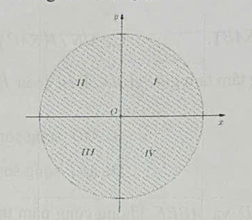
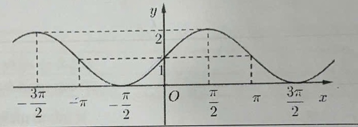
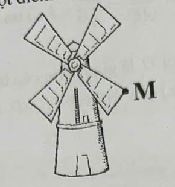

# Bộ bài tập LG1 và LG2 — 50 câu mỗi phần

Mỗi phần xếp theo Dễ → Trung bình → Khó; trong mỗi mức độ gom theo chủ đề. Mỗi ý đúng/sai là một câu. Thứ tự câu cố định, lựa chọn được xáo trộn trên trang. Mức độ là phân loại phục vụ ôn tập, dựa trên số bước giải và mức phối hợp kiến thức.

## Lượng giác 1

Dễ: 15, Trung bình: 18, Khó: 17

### Dễ — Góc và radian

#### Câu 1 · A-I-1

Khẳng định nào đúng về góc lượng giác?

A. Trên đường tròn tâm O bán kính 1, góc hình học AOB là góc lượng giác.
B. Trên đường tròn tâm O bán kính 1, góc hình học AOB phân biệt điểm đầu A và điểm cuối B là góc lượng giác.
C. Trên đường tròn định hướng, góc hình học AOB là góc lượng giác.
D. Trên đường tròn định hướng, góc hình học AOB phân biệt điểm đầu A và điểm cuối B là góc lượng giác.

**Đáp án: D — Trên đường tròn định hướng, góc hình học AOB phân biệt điểm đầu A và điểm cuối B là góc lượng giác.**

Theo quy ước của đề: đường tròn định hướng, phân biệt điểm đầu và điểm cuối.

#### Câu 2 · A-I-2

Khẳng định nào đúng về đường tròn lượng giác?

A. Mọi đường tròn là đường tròn lượng giác.
B. Mọi đường tròn bán kính 1 là đường tròn lượng giác.
C. Mọi đường tròn bán kính 1, tâm tại gốc tọa độ là đường tròn lượng giác.
D. Đường tròn định hướng bán kính 1, tâm tại gốc tọa độ là đường tròn lượng giác.

**Đáp án: D — Đường tròn định hướng bán kính 1, tâm tại gốc tọa độ là đường tròn lượng giác.**

Đường tròn lượng giác có tâm O, bán kính 1, gắn chiều định hướng.

#### Câu 3 · A-I-3

Cung có số đo 1 rad là cung có độ dài:

A. Bằng 1.
B. Tương ứng với góc ở tâm $60^\circ$.
C. Bằng đường kính.
D. Bằng nửa đường kính.

**Đáp án: D — Bằng nửa đường kính.**

Định nghĩa radian: l=Rα; α=1 nên l=R, bằng nửa đường kính.

#### Câu 4 · A-I-4

Đổi $108^\circ$ sang radian.

A. $\frac{3\pi}{5}$
B. $\frac\pi{10}$
C. $\frac{3\pi}{2}$
D. $\frac\pi4$

**Đáp án: A — $\frac{3\pi}{5}$**

108°×π/180=3π/5.

#### Câu 5 · B-I-39

Đổi $22^\circ30\prime$ sang radian.

A. $\frac\pi5$
B. $\frac\pi8$
C. $\frac{7\pi}{12}$
D. $\frac\pi6$

**Đáp án: B — $\frac\pi8$**

22°30′=22,5°=π/8.

#### Câu 6 · A-II-1 c

Các góc sau có cùng điểm biểu diễn trên đường tròn lượng giác?

$36^\circ$ và $216^\circ$.

A. Đúng
B. Sai

**Đáp án: B — Sai**

Chênh −180°, hai điểm đối nhau.

#### Câu 7 · B-II-1 d

Trên đường tròn lượng giác, xét vị trí của các điểm:

$-\frac{13\pi}6$ thuộc góc phần tư IV.

A. Đúng
B. Sai

**Đáp án: A — Đúng**

−13π/6 đồng vị 11π/6, thuộc IV.

### Dễ — Hệ thức cơ bản và dấu

#### Câu 8 · A-I-14

Mệnh đề nào sai?

A. $-1\le\sin\alpha\le1;\ -1\le\cos\alpha\le1$
B. $\tan\alpha=\frac{\sin\alpha}{\cos\alpha},\ \cos\alpha\ne0$
C. $\cot\alpha=\frac{\cos\alpha}{\sin\alpha},\ \sin\alpha\ne0$
D. $\sin^2(2018\alpha)+\cos^2(2018\alpha)=2018$

**Đáp án: D — $\sin^2(2018\alpha)+\cos^2(2018\alpha)=2018$**

sin²t+cos²t=1 với mọi t; thay t=2018α vẫn bằng 1, không bằng 2018.

#### Câu 9 · A-I-15

Điều kiện trong đẳng thức $\tan\alpha\cot\alpha=1$ là ($k\in\mathbb Z$):

A. $\alpha\ne\frac{k\pi}2$
B. $\alpha\ne\frac\pi2+k\pi$
C. $\alpha\ne k\pi$
D. $\alpha\ne\frac\pi2+2k\pi$

**Đáp án: A — $\alpha\ne\frac{k\pi}2$**

Cần đồng thời sinα≠0 và cosα≠0, tương đương α≠kπ/2.

#### Câu 10 · B-I-54

Cho $\sin x=\frac12$. Tính $\cos^2x$.

A. $\frac34$
B. $\frac{\sqrt3}2$
C. $\frac14$
D. $\frac12$

**Đáp án: A — $\frac34$**

cos²x=1−sin²x=3/4.

#### Câu 11 · B-I-46

Khẳng định nào sai?

A. $\sin(-\alpha)=-\sin\alpha$
B. $\cot(-\alpha)=-\cot\alpha$
C. $\cos(-\alpha)=-\cos\alpha$
D. $\tan(-\alpha)=-\tan\alpha$

**Đáp án: C — $\cos(-\alpha)=-\cos\alpha$**

cos là hàm chẵn: cos(−α)=cosα, không phải −cosα.

### Dễ — Nhận biết công thức

#### Câu 12 · B-I-56

Công thức nào đúng?

A. $\cos(a-b)=\cos a\sin b+\sin a\sin b$
B. $\sin(a-b)=\sin a\cos b-\cos a\sin b$
C. $\sin(a+b)=\sin a\cos b-\cos a\sin b$
D. $\cos(a+b)=\cos a\cos b+\sin a\sin b$

**Đáp án: B — $\sin(a-b)=\sin a\cos b-\cos a\sin b$**

Công thức sin(a−b)=sina cosb−cosa sinb.

#### Câu 13 · B-I-57

Công thức nào đúng?

A. $\tan(a-b)=\frac{\tan a+\tan b}{1-\tan a\tan b}$
B. $\tan(a-b)=\tan a-\tan b$
C. $\tan(a+b)=\frac{\tan a+\tan b}{1-\tan a\tan b}$
D. $\tan(a+b)=\tan a+\tan b$

**Đáp án: C — $\tan(a+b)=\frac{\tan a+\tan b}{1-\tan a\tan b}$**

tan(a+b)=(tana+tanb)/(1−tana tanb) trên miền xác định.

#### Câu 14 · B-I-58

$\sin x\cos y-\cos x\sin y$ bằng:

A. $\cos(x-y)$
B. $\cos(x+y)$
C. $\sin(x-y)$
D. $\sin(y-x)$

**Đáp án: C — $\sin(x-y)$**

Biểu thức là sin(x−y).

#### Câu 15 · B-I-69

Công thức nào sai?

A. $\cos2a=\cos^2a-\sin^2a$
B. $\cos2a=\cos^2a+\sin^2a$
C. $\cos2a=2\cos^2a-1$
D. $\cos2a=1-2\sin^2a$

**Đáp án: B — $\cos2a=\cos^2a+\sin^2a$**

cos²a+sin²a=1 không đồng nhất cos2a.

### Trung bình — Góc và chuyển động tròn

#### Câu 16 · A-I-6

Tính độ dài cung trên đường tròn bán kính 20 cm, có số đo $\frac\pi{16}$.

A. 3,93 cm
B. 2,94 cm
C. 3,39 cm
D. 1,49 cm

**Đáp án: A — 3,93 cm**

l=20π/16=5π/4≈3,92699 cm, làm tròn 3,93 cm.

#### Câu 17 · A-I-9

Bánh xe quay 2 vòng trong 5 giây. Trong 2 giây bánh xe quay góc bao nhiêu?

A. $\frac{8\pi}5$
B. $\frac{5\pi}8$
C. $\frac{3\pi}5$
D. $\frac{5\pi}3$

**Đáp án: A — $\frac{8\pi}5$**

2 giây quay 4/5 vòng, góc 8π/5.

#### Câu 18 · B-I-36

Cho $a=\frac\pi2+2k\pi$. Tìm k để $10\pi<a<11\pi$.

A. 7
B. 5
C. 4
D. 6

**Đáp án: B — 5**

10<1/2+2k<11 ⇔ 4,75<k<5,25, nguyên duy nhất k=5.

#### Câu 19 · B-I-37

Một bánh xe có 72 răng. Khi di chuyển 10 răng, bánh xe quay góc:

A. $60^\circ$
B. $30^\circ$
C. $40^\circ$
D. $50^\circ$

**Đáp án: D — $50^\circ$**

10/72 vòng ×360°=50°.

### Trung bình — Tính giá trị và xác định dấu

#### Câu 20 · A-I-11

Cho $0<\alpha<\frac\pi2$. Khẳng định nào đúng?

A. $\cot(\alpha+\frac\pi2)>0$
B. $\cot(\alpha+\frac\pi2)\ge0$
C. $\tan(\alpha+\pi)<0$
D. $\tan(\alpha+\pi)>0$

**Đáp án: D — $\tan(\alpha+\pi)>0$**

α thuộc góc phần tư I: cot(α+π/2)=−tanα<0; tan(α+π)=tanα>0.

#### Câu 21 · B-I-48

Cho $\sin\alpha=\frac35$, $90^\circ<\alpha<180^\circ$. Tính $\cot\alpha$.

A. $\frac34$
B. $\frac43$
C. $-\frac43$
D. $-\frac34$

**Đáp án: C — $-\frac43$**

sinα=3/5 ở góc phần tư II ⇒ cosα=−4/5, cotα=−4/3.

#### Câu 22 · B-I-50

Cho $\sin\alpha=\frac13$, $\frac\pi2<\alpha<\pi$. Tính $\cos\alpha$.

A. $-\frac23$
B. $\frac{2\sqrt2}3$
C. $\frac89$
D. $-\frac{2\sqrt2}3$

**Đáp án: D — $-\frac{2\sqrt2}3$**

cosα=−√(1−1/9)=−2√2/3.

#### Câu 23 · B-II-3 c

Biết $\sin x=-\frac35$, $\pi<x<\frac{3\pi}2$.

$\tan x=\frac34$.

A. Đúng
B. Sai

**Đáp án: A — Đúng**

tanx=3/4.

#### Câu 24 · B-II-4 d

Biết $\cos x=-\frac5{13}$, $180^\circ<x<270^\circ$.

$\sin x-\cos x=-\frac{12}{13}$.

A. Đúng
B. Sai

**Đáp án: B — Sai**

sinx−cosx=−7/13, không phải −12/13.

### Trung bình — Biến đổi và rút gọn

#### Câu 25 · A-I-16

Rút gọn $S=\cos(\frac\pi2-x)\sin(\pi-x)-\sin(\frac\pi2-x)\cos(\pi-x)$.

A. $0$
B. $\sin^2x-\cos^2x$
C. $2\sin x\cos x$
D. $1$

**Đáp án: D — $1$**

S=sin²x+cos²x=1.

#### Câu 26 · A-I-18

Rút gọn $M=(\sin x+\cos x)^2+(\sin x-\cos x)^2$.

A. $1$
B. $2$
C. $4$
D. $4\sin x\cos x$

**Đáp án: B — $2$**

Tổng hai bình phương bằng 2(sin²x+cos²x)=2.

#### Câu 27 · A-I-19

Đơn giản $P=\frac{1+\sin^2\alpha}{1-\sin^2\alpha}$.

A. $1+2\tan^2\alpha$
B. $1-2\tan^2\alpha$
C. $-1+2\tan^2\alpha$
D. $-1-2\tan^2\alpha$

**Đáp án: A — $1+2\tan^2\alpha$**

(1+sin²α)/cos²α=1+2tan²α.

#### Câu 28 · A-I-20

Đơn giản $P=\frac{1-\cos\alpha}{\sin^2\alpha}-\frac1{1+\cos\alpha}$.

A. $-\frac{2\cos\alpha}{\sin^2\alpha}$
B. $\frac2{\sin^2\alpha}$
C. $\frac2{1+\cos\alpha}$
D. $0$

**Đáp án: D — $0$**

(1−cosα)/sin²α=1/(1+cosα); hiệu bằng 0 trên miền xác định.

#### Câu 29 · A-I-23

Rút gọn $M=\sin(x-y)\cos y+\cos(x-y)\sin y$.

A. $\cos x$
B. $\sin x$
C. $\sin x\cos2y$
D. $\cos x\cos2y$

**Đáp án: B — $\sin x$**

sin(x−y)cosy+cos(x−y)siny=sinx.

#### Câu 30 · A-I-24

Rút gọn $M=\cos(x+\frac\pi4)-\cos(x-\frac\pi4)$.

A. $\sqrt2\sin x$
B. $-\sqrt2\sin x$
C. $\sqrt2\cos x$
D. $-\sqrt2\cos x$

**Đáp án: B — $-\sqrt2\sin x$**

cosu−cosv=−2sin((u+v)/2)sin((u−v)/2), cho −√2sinx.

#### Câu 31 · B-I-62

Rút gọn $\sin(a-17^\circ)\cos(a+13^\circ)-\sin(a+13^\circ)\cos(a-17^\circ)$.

A. $\sin2a$
B. $\cos2a$
C. $-\frac12$
D. $\frac12$

**Đáp án: C — $-\frac12$**

sinU cosV−sinV cosU=sin(U−V)=sin(−30°)=−1/2.

### Trung bình — Phân biệt công thức

#### Câu 32 · B-I-60

Khẳng định nào sai?

A. $\sin a-\sin b=2\cos\frac{a+b}2\sin\frac{a-b}2$
B. $\cos(a-b)=\cos a\cos b-\sin a\sin b$
C. $\sin(a-b)=\sin a\cos b-\cos a\sin b$
D. $2\cos a\cos b=\cos(a-b)+\cos(a+b)$

**Đáp án: B — $\cos(a-b)=\cos a\cos b-\sin a\sin b$**

cos(a−b) phải có dấu cộng trước sina sinb.

#### Câu 33 · B-I-73

Công thức nào sai?

A. $\cos a+\cos b=2\cos\frac{a+b}2\cos\frac{a-b}2$
B. $\cos a-\cos b=-2\sin\frac{a+b}2\sin\frac{a-b}2$
C. $\sin a+\sin b=2\sin\frac{a+b}2\cos\frac{a-b}2$
D. $\sin a-\sin b=2\sin\frac{a+b}2\cos\frac{a-b}2$

**Đáp án: D — $\sin a-\sin b=2\sin\frac{a+b}2\cos\frac{a-b}2$**

sin a−sin b phải bằng 2cos((a+b)/2)sin((a−b)/2).

### Khó — Tính giá trị tổng hợp

#### Câu 34 · A-I-17

Cho $3\cos\alpha+2\sin\alpha=2$ và $\sin\alpha<0$. Tính $\sin\alpha$.

A. $-\frac5{13}$
B. $-\frac7{13}$
C. $-\frac9{13}$
D. $-\frac{12}{13}$

**Đáp án: A — $-\frac5{13}$**

Đặt s=sinα, cosα=(2−2s)/3. Từ sin²+cos²=1: 13s²−8s−5=0, s=1 hoặc −5/13; điều kiện s<0 chọn −5/13.

#### Câu 35 · B-I-51

Cho $\cot\alpha=-3\sqrt2$, $\frac\pi2<\alpha<\pi$. Tính $\tan\frac\alpha2+\cot\frac\alpha2$.

A. $2\sqrt{19}$
B. $-2\sqrt{19}$
C. $-\sqrt{19}$
D. $\sqrt{19}$

**Đáp án: A — $2\sqrt{19}$**

tan(α/2)+cot(α/2)=2/sinα; sinα=1/√19>0 nên kết quả 2√19.

#### Câu 36 · B-I-55

Cho $P=\frac{3\sin x-\cos x}{\sin x+2\cos x}$, $\tan x=2$. Tính P.

A. $\frac89$
B. $-\frac{2\sqrt2}3$
C. $\frac{\sqrt8}9$
D. $\frac54$

**Đáp án: D — $\frac54$**

Chia tử và mẫu cho cosx: (3tanx−1)/(tanx+2)=5/4.

#### Câu 37 · B-I-63

Tính $\cos\frac{37\pi}{12}$.

A. $\frac{\sqrt6+\sqrt2}4$
B. $\frac{\sqrt6-\sqrt2}4$
C. $-\frac{\sqrt6+\sqrt2}4$
D. $\frac{\sqrt2-\sqrt6}4$

**Đáp án: C — $-\frac{\sqrt6+\sqrt2}4$**

37π/12=3π+π/12; cos=−cos15°=−(√6+√2)/4.

#### Câu 38 · B-I-65

Cho $\tan\alpha=2$. Tính $\tan(\alpha-\frac\pi4)$.

A. $-\frac13$
B. $1$
C. $\frac23$
D. $\frac13$

**Đáp án: D — $\frac13$**

tan(α−π/4)=(2−1)/(1+2)=1/3.

#### Câu 39 · B-I-74

Cho $\sin x=\frac35$, $\frac\pi2<x<\pi$. Tính $\tan(x+\frac\pi4)$.

A. $\frac27$
B. $-\frac17$
C. $-\frac27$
D. $\frac17$

**Đáp án: D — $\frac17$**

cosx=−4/5 ⇒ tanx=−3/4; tan(x+π/4)=(1−3/4)/(1+3/4)=1/7.

#### Câu 40 · A-II-3 c

Cho $\sin\alpha=\frac23$, $\frac\pi2<\alpha<\pi$.

$\cos(\frac\pi3+\alpha)=\frac{\sqrt5-2\sqrt3}6$.

A. Đúng
B. Sai

**Đáp án: B — Sai**

Giá trị đúng là (−√5−2√3)/6.

#### Câu 41 · B-II-5 d

Cho $\cos2\alpha=-\frac14$, $\pi<\alpha<\frac{3\pi}2$.

$\cot\alpha=\frac{\sqrt{15}}5$.

A. Đúng
B. Sai

**Đáp án: A — Đúng**

cotα=√6/√10=√15/5.

#### Câu 42 · B-II-6 d

Cho $\sin x=\frac1{\sqrt3}$, $0<x<\frac\pi2$.

$\cos(x+\frac\pi3)=\frac{\sqrt6-3}8$.

A. Đúng
B. Sai

**Đáp án: B — Sai**

Giá trị đúng là (√6−3)/6, không phải chia 8.

#### Câu 43 · B-II-8 b

Cho $\sin x=\frac15$, $\frac\pi2<x<\pi$.

$\cos2x=\frac{23}{25}$.

A. Đúng
B. Sai

**Đáp án: A — Đúng**

cos2x=1−2/25=23/25.

#### Câu 44 · B-III-4

Cho $\frac\pi2<\alpha,\beta<\pi$, $\sin\alpha=\frac13$, $\cos\beta=-\frac23$. Tính $\sin(\alpha+\beta)$.

A. $-\frac{2+2\sqrt{10}}9$
B. $\frac{2+2\sqrt{10}}9$
C. $\frac{2\sqrt{10}-2}9$
D. $-\frac29$

**Đáp án: A — $-\frac{2+2\sqrt{10}}9$**

cosα=−2√2/3,sinβ=√5/3. sin(α+β)=−2/9−2√10/9. Kết quả: −(2+2√10)/9

### Khó — Rút gọn tổng hợp

#### Câu 45 · A-I-25

Rút gọn $A=\frac{\sin2\alpha+\sin\alpha}{1+\cos2\alpha+\cos\alpha}$.

A. $\tan\alpha$
B. $2\tan\alpha$
C. $\tan2\alpha+\tan\alpha$
D. $\tan2\alpha$

**Đáp án: A — $\tan\alpha$**

Tử=sinα(2cosα+1), mẫu=cosα(2cosα+1), thương=tanα khi biểu thức xác định.

#### Câu 46 · A-I-26

Rút gọn $A=\frac{1-\sin a-\cos2a}{\sin2a-\cos a}$.

A. $1$
B. $\tan a$
C. $\frac52$
D. $2\tan a$

**Đáp án: B — $\tan a$**

Tử=sin a(2sin a−1), mẫu=cos a(2sin a−1), thương=tan a trên miền xác định.

#### Câu 47 · B-I-61

$\frac{\sin(a+b)}{\sin(a-b)}$ bằng biểu thức nào? Giả sử các biểu thức có nghĩa.

A. $\frac{\sin a+\sin b}{\sin a-\sin b}$
B. $\frac{\sin a-\sin b}{\sin a+\sin b}$
C. $\frac{\tan a+\tan b}{\tan a-\tan b}$
D. $\frac{\cot a+\cot b}{\cot a-\cot b}$

**Đáp án: C — $\frac{\tan a+\tan b}{\tan a-\tan b}$**

Khai triển sin(a±b), chia cho cosa cosb: thương=(tana+tanb)/(tana−tanb). D là số đối, không tương đương.

#### Câu 48 · B-III-3

Cho $S=\frac{\sin(\frac{15\pi}2-x)-2\cos(x-\pi)}{\cos(\frac{5\pi}2-x)}=k\cot x$. Tìm k.

A. $1$
B. $-1$
C. $2$
D. $3$

**Đáp án: A — $1$**

sin(15π/2−x)=−cosx; −2cos(x−π)=2cosx; mẫu cos(5π/2−x)=sinx. S=cotx. Kết quả: 1

### Khó — Ứng dụng thực tế

#### Câu 49 · A-III-4

Một người ngắm bắn từ mặt đất vào tường thẳng đứng. Ở góc ngắm ban đầu, mục tiêu cao 25 m; khi giảm góc ngắm còn một nửa, mục tiêu cao 10 m. Khoảng cách từ người đến tường là bao nhiêu?

A. $10\sqrt5\ \mathrm m$
B. $5\sqrt5\ \mathrm m$
C. $20\ \mathrm m$
D. $25\ \mathrm m$

**Đáp án: A — $10\sqrt5\ \mathrm m$**

Đặt d là khoảng cách, tan(θ/2)=10/d và tanθ=25/d. Công thức nhân đôi cho d²=500. Kết quả: 10√5 m

#### Câu 50 · B-III-13

Bánh xe đường kính 55 cm chạy với tốc độ 50 km/h. Trong một giây quay bao nhiêu vòng (làm tròn hàng phần trăm)?

A. $8{,}04$
B. $4{,}02$
C. $16{,}08$
D. $80{,}4$

**Đáp án: A — $8{,}04$**

Vận tốc=125/9 m/s; chu vi=0,55π m; số vòng=2500/(99π)≈8,03813. Kết quả: 8,04 vòng

## Lượng giác 2

Dễ: 16, Trung bình: 20, Khó: 14

### Dễ — Tập xác định

#### Câu 1 · A-I-30

Tập xác định của $y=\sqrt{\sin x+2}$ là:

A. $\mathbb R$
B. $[-2;+\infty)$
C. $[0;2\pi]$
D. $\varnothing$

**Đáp án: A — $\mathbb R$**

sinx+2≥1>0, xác định với mọi x thực.

#### Câu 2 · B-I-5

Tập xác định của $y=\frac1{\sin x-\cos x}$ là ($k\in\mathbb Z$):

A. $x\ne2k\pi$
B. $x\ne k\pi$
C. $x\ne\frac\pi4+k\pi$
D. $x\ne\frac\pi2+k\pi$

**Đáp án: C — $x\ne\frac\pi4+k\pi$**

Mẫu bằng 0 khi x=π/4+kπ.

### Dễ — Tập giá trị và biên độ

#### Câu 3 · A-I-27

Tìm giá trị lớn nhất M và nhỏ nhất m của $P=3\sin x-2$.

A. $M=1,m=-5$
B. $M=3,m=1$
C. $M=2,m=-2$
D. $M=0,m=-2$

**Đáp án: A — $M=1,m=-5$**

sinx∈[−1;1] nên 3sinx−2∈[−5;1].

#### Câu 4 · A-I-33

Tập giá trị của $y=3\cos2x+5$ là:

A. $[-1;1]$
B. $[-1;11]$
C. $[2;8]$
D. $[5;8]$

**Đáp án: C — $[2;8]$**

−1≤cos2x≤1 nên 2≤3cos2x+5≤8.

#### Câu 5 · B-III-23

Sóng biển được mô hình bởi $h(t)=90\cos(\frac\pi{10}t)$ cm. Chiều cao từ đáy đến đỉnh sóng là bao nhiêu?

A. $180\ \mathrm{cm}$
B. $90\ \mathrm{cm}$
C. $45\ \mathrm{cm}$
D. $360\ \mathrm{cm}$

**Đáp án: A — $180\ \mathrm{cm}$**

Chiều cao đỉnh−đáy=90−(−90)=180 cm. Kết quả: 180 cm

### Dễ — Chu kỳ

#### Câu 6 · B-I-20

Chu kỳ của $y=1+\sin2x$ là:

A. $\pi$
B. $\frac\pi2$
C. $4\pi$
D. $2\pi$

**Đáp án: A — $\pi$**

Chu kỳ cơ bản sin2x là π.

#### Câu 7 · B-I-98

Tìm chu kỳ của $y=\cos(\frac x2+2021)$.

A. $4\pi$
B. $2\pi$
C. $-2\pi$
D. $\pi$

**Đáp án: A — $4\pi$**

Chu kỳ cos(x/2+2021) là 2π/(1/2)=4π.

### Dễ — Hàm chẵn, hàm lẻ

#### Câu 8 · B-I-8

Hàm số nào chẵn trên ℝ?

A. $y=\frac{\tan x}{1+x^2}$
B. $y=x\cos2x$
C. $y=(x^2+1)\sin x$
D. $y=\frac{\cos x}{1+x^2}$

**Đáp án: D — $y=\frac{\cos x}{1+x^2}$**

cosx/(1+x²) có miền R và là hàm chẵn; ba hàm còn lại lẻ hoặc không xác định trên toàn R.

#### Câu 9 · A-I-32

Hàm số nào lẻ?

A. $y=\cos x+\sin^2x$
B. $y=\sin x+\cos x$
C. $y=-\cos x$
D. $y=\sin x\cos3x$

**Đáp án: D — $y=\sin x\cos3x$**

sinx là hàm lẻ, cos3x chẵn, tích lẻ; các lựa chọn khác không lẻ.

#### Câu 10 · B-I-76

Hàm số nào có đồ thị đối xứng qua gốc tọa độ?

A. $y=\cot4x$
B. $y=\frac{\sin x+1}{\cos x}$
C. $y=\tan^2x$
D. $y=|\cot x|$

**Đáp án: A — $y=\cot4x$**

cot4x lẻ trên miền đối xứng; các hàm khác không lẻ.

### Dễ — Phương trình cơ bản

#### Câu 11 · B-I-2

Nghiệm của $\sin x=-1$ là ($k\in\mathbb Z$):

A. $x=-\frac\pi2+k\pi$
B. $x=k\pi$
C. $x=-\frac\pi2+2k\pi$
D. $x=\frac{3\pi}2+k\pi$

**Đáp án: C — $x=-\frac\pi2+2k\pi$**

sinx=−1 ⇔ x=−π/2+2kπ.

#### Câu 12 · B-I-4

Nghiệm của $2\cos2x=-2$ là ($k\in\mathbb Z$):

A. $x=\pi+2k\pi$
B. $x=\frac\pi2+2k\pi$
C. $x=2k\pi$
D. $x=\frac\pi2+k\pi$

**Đáp án: D — $x=\frac\pi2+k\pi$**

cos2x=−1 ⇔ 2x=π+2kπ ⇔ x=π/2+kπ.

#### Câu 13 · B-I-10

Nghiệm đặc biệt nào sai? ($k\in\mathbb Z$)

A. $\sin x=0\Leftrightarrow x=k\pi$
B. $\sin x=0\Leftrightarrow x=2k\pi$
C. $\sin x=1\Leftrightarrow x=\frac\pi2+2k\pi$
D. $\sin x=-1\Leftrightarrow x=-\frac\pi2+2k\pi$

**Đáp án: B — $\sin x=0\Leftrightarrow x=2k\pi$**

sinx=0 có cả x=π, không chỉ các bội chẵn của π.

#### Câu 14 · B-I-13

Phương trình nào vô nghiệm?

A. $\tan x+3=0$
B. $3\sin x-2=0$
C. $2\cos2x-\cos x-1=0$
D. $\sin x+3=0$

**Đáp án: D — $\sin x+3=0$**

sinx=−3 vô nghiệm. Ba phương trình khác có nghiệm (phương trình C có x=0).

#### Câu 15 · B-I-19

Nghiệm dương bé nhất của $2\sin x-1=0$ là:

A. $\frac\pi6$
B. $\frac{5\pi}6$
C. $\frac\pi2$
D. $\frac{3\pi}2$

**Đáp án: A — $\frac\pi6$**

sinx=1/2, nghiệm dương đầu tiên π/6.

### Dễ — Đọc đồ thị

#### Câu 16 · B-II-10 d

Hàm số y=f(x) có đồ thị như hình. Xét các mệnh đề:

Tập giá trị là $[0;2]$.

A. Đúng
B. Sai

**Đáp án: A — Đúng**

Đồ thị có min=0,max=2, tập giá trị [0;2].

### Trung bình — Tập xác định

#### Câu 17 · A-I-29

Tập xác định của $y=\frac{3\tan x-5}{1-\sin^2x}$ là:

A. $\mathbb R\setminus\{\frac\pi2+2k\pi:k\in\mathbb Z\}$
B. $\mathbb R\setminus\{\frac\pi2+k\pi:k\in\mathbb Z\}$
C. $\mathbb R\setminus\{\pi+k\pi:k\in\mathbb Z\}$
D. $x\ne k\pi,\ k\in\mathbb Z$

**Đáp án: B — $\mathbb R\setminus\{\frac\pi2+k\pi:k\in\mathbb Z\}$**

Cần cosx≠0 cho tanx; mẫu=cos²x nên cùng điều kiện x≠π/2+kπ.

#### Câu 18 · B-I-15

Điều kiện xác định của $y=\frac{\tan x}{\cos x-1}$ là ($k\in\mathbb Z$):

A. $x\ne\frac\pi2+k\pi,\ x\ne\frac\pi3+k\pi$
B. $x\ne2k\pi$
C. $x=\frac\pi3+2k\pi$
D. $x\ne\frac\pi2+k\pi,\ x\ne2k\pi$

**Đáp án: D — $x\ne\frac\pi2+k\pi,\ x\ne2k\pi$**

Cần cosx≠0 và cosx≠1: x≠π/2+kπ, x≠2kπ.

### Trung bình — Cực trị hàm số

#### Câu 19 · B-I-6

Giá trị nhỏ nhất và lớn nhất của $y=4\sqrt{\sin x+3}-1$ lần lượt là:

A. $4\sqrt2$ và $8$
B. $\sqrt2$ và $2$
C. $4\sqrt2-1$ và $7$
D. $2$ và $4$

**Đáp án: C — $4\sqrt2-1$ và $7$**

sinx+3∈[2;4], căn∈[√2;2], y∈[4√2−1;7].

#### Câu 20 · A-III-1

Tìm giá trị nhỏ nhất của $y=-\sqrt2\sin2016x+2017$.

A. $2017-\sqrt2$
B. $2017+\sqrt2$
C. $2015$
D. $2017$

**Đáp án: A — $2017-\sqrt2$**

min=2017−|−√2|=2017−√2. Kết quả: 2017−√2

#### Câu 21 · B-III-6

Tìm giá trị lớn nhất của $y=\sqrt{1+\sin x}-3$.

A. $\sqrt2-3$
B. $\sqrt2+3$
C. $-3$
D. $-1$

**Đáp án: A — $\sqrt2-3$**

Căn lớn nhất √(1+1)=√2, trừ 3. Kết quả: √2−3

### Trung bình — Chu kỳ

#### Câu 22 · B-I-99

Tìm chu kỳ của $y=-\frac12\sin(100\pi x+50\pi)$.

A. $\frac1{50}$
B. $\frac1{100}$
C. $\frac\pi{50}$
D. $200\pi^2$

**Đáp án: A — $\frac1{50}$**

Chu kỳ 2π/(100π)=1/50.

#### Câu 23 · B-III-5

Tìm chu kỳ của $f(x)=\tan2x$, làm tròn đến hàng phần trăm.

A. $1{,}57$
B. $3{,}14$
C. $0{,}79$
D. $6{,}28$

**Đáp án: A — $1{,}57$**

T=π/2≈1,570796, làm tròn hàng phần trăm=1,57. Kết quả: 1,57

### Trung bình — Hàm chẵn, hàm lẻ

#### Câu 24 · A-I-31

Hàm số nào chẵn?

A. $y=\sin2x$
B. $y=x\cos x$
C. $y=\cos x\cot x$
D. $y=\frac{\tan x}{\sin x}$

**Đáp án: D — $y=\frac{\tan x}{\sin x}$**

tanx/sinx=1/cosx trên miền sinx cosx≠0; miền đối xứng và hàm chẵn.

#### Câu 25 · B-I-18

Hàm số nào lẻ trên tập xác định của nó?

A. $y=\frac{\cos x}{x+x^2}$
B. $y=\frac{\sin x}{1-\sin x}$
C. $y=\frac{\tan x}{1+\sin^2x}$
D. $y=\frac{\sin^2x}{1+\cos x}$

**Đáp án: C — $y=\frac{\tan x}{1+\sin^2x}$**

tanx lẻ, 1+sin²x chẵn dương, miền loại π/2+kπ đối xứng nên thương lẻ.

#### Câu 26 · B-II-9 b

Cho hàm số $f(x)=\sin^2x+\cos x-1$.

$f(-\pi)=-f(\pi)$.

A. Đúng
B. Sai

**Đáp án: B — Sai**

f(−π)=f(π)=−2, không bằng −f(π)=2.

### Trung bình — Giải phương trình

#### Câu 27 · B-I-11

Giải $2\cos\frac x2+\sqrt3=0$ ($k\in\mathbb Z$).

A. $x=\pm\frac{5\pi}6+2k\pi$
B. $x=\pm\frac{5\pi}6+4k\pi$
C. $x=\pm\frac{5\pi}3+4k\pi$
D. $x=\pm\frac{5\pi}3+2k\pi$

**Đáp án: C — $x=\pm\frac{5\pi}3+4k\pi$**

cos(x/2)=−√3/2 ⇔ x/2=±5π/6+2kπ ⇔ x=±5π/3+4kπ.

#### Câu 28 · B-I-12

Giải $2\cot x-\sqrt3=0$ ($k\in\mathbb Z$).

A. $x=\frac\pi6+k\pi$
B. $x=\pm\frac\pi6+2k\pi$
C. $x=\operatorname{arccot}(\frac{\sqrt3}2)+k\pi$
D. $x=\frac\pi3+k\pi$

**Đáp án: C — $x=\operatorname{arccot}(\frac{\sqrt3}2)+k\pi$**

cotx=√3/2. Đây không phải cotπ/6 hay cotπ/3; nghiệm arccot(√3/2)+kπ.

#### Câu 29 · B-I-22

Điều kiện cần và đủ để $4\cos x-m=0$ vô nghiệm là:

A. $m<-4$ hoặc $m>4$
B. $-4<m<4$
C. $m>4$
D. $m<-4$

**Đáp án: A — $m<-4$ hoặc $m>4$**

4cosx∈[−4;4]; vô nghiệm khi m nằm ngoài đoạn đóng.

#### Câu 30 · B-I-23

Nghiệm dương bé nhất của $2\cos x+\sqrt3=0$ là:

A. $\frac\pi6$
B. $\frac{5\pi}6$
C. $\frac\pi2$
D. $\frac{3\pi}2$

**Đáp án: B — $\frac{5\pi}6$**

cosx=−√3/2, nghiệm dương đầu tiên 5π/6.

#### Câu 31 · B-I-26

Nghiệm của $\cos^2x-\cos x=0$ thỏa $0<x<\pi$ là:

A. $-\frac\pi2$
B. $0$
C. $\pi$
D. $\frac\pi2$

**Đáp án: D — $\frac\pi2$**

cosx(cosx−1)=0; trong (0;π) chỉ có x=π/2.

#### Câu 32 · B-I-29

Nghiệm của $\sin x=\frac12$ trong $[-\frac\pi2;\frac\pi2]$ là:

A. $x=\frac{5\pi}6+2k\pi$
B. $x=\frac\pi6$
C. $x=\frac\pi3$
D. $x=\frac\pi3+2k\pi$

**Đáp án: B — $x=\frac\pi6$**

sin đơn điệu trên [−π/2;π/2], nghiệm duy nhất π/6.

### Trung bình — Đơn điệu và đồ thị

#### Câu 33 · B-I-72

Hàm số nào nghịch biến trên $(0;\frac\pi2)$?

A. $y=\sin x$
B. $y=\cos x$
C. $y=\tan x$
D. $y=-\cot x$

**Đáp án: B — $y=\cos x$**

Trên (0;π/2), đạo hàm cosx là −sinx<0; ba hàm còn lại đồng biến.

#### Câu 34 · B-I-100

Hàm số nào đồng biến trên $(-\frac\pi3;\frac\pi6)$?

A. $y=\cos x$
B. $y=\cot2x$
C. $y=\sin x$
D. $y=\cos2x$

**Đáp án: C — $y=\sin x$**

cosx>0 trên (−π/3;π/6), nên đạo hàm sinx dương. Các lựa chọn khác không đồng biến trên toàn khoảng.

#### Câu 35 · B-II-10 b

Hàm số y=f(x) có đồ thị như hình. Xét các mệnh đề:

Hàm số đồng biến trên $(-\pi;0)$.

A. Đúng
B. Sai

**Đáp án: B — Sai**

Trên (−π;−π/2) đồ thị đang giảm, nên không tăng trên toàn (−π;0).

### Trung bình — Ứng dụng hàm số

#### Câu 36 · B-III-19

Mực nước sông được cho bởi $h=-4\sin(\frac{\pi t}6+\frac\pi3)+5$ mét. Tính độ sâu lúc 9 giờ sáng.

A. $7\ \mathrm m$
B. $3\ \mathrm m$
C. $5\ \mathrm m$
D. $9\ \mathrm m$

**Đáp án: A — $7\ \mathrm m$**

Góc tại t=9 là 11π/6, sin=−1/2; h=−4×(−1/2)+5=7. Kết quả: 7 m

### Khó — Cực trị và biến đổi

#### Câu 37 · B-I-24

Giá trị lớn nhất của $y=1-2\cos x-\cos^2x$ là:

A. 0
B. 5
C. 2
D. 3

**Đáp án: C — 2**

Đặt t=cosx∈[−1;1], y=2−(t+1)²≤2, đạt tại t=−1.

#### Câu 38 · A-III-2

Tìm giá trị lớn nhất của $y=\frac2{1+\tan^2x}$.

A. $2$
B. $1$
C. $0$
D. $4$

**Đáp án: A — $2$**

y=2cos²x≤2; đạt tại x=kπ, thuộc miền xác định. Kết quả: 2

#### Câu 39 · B-III-8

Tập giá trị của $y=5+4\sin2x\cos2x$ là $[a;b]$. Tính $S=a^2-2ab$.

A. $-33$
B. $-21$
C. $33$
D. $-45$

**Đáp án: A — $-33$**

y=5+2sin4x∈[3;7]; a²−2ab=9−42=−33. Kết quả: −33

### Khó — Điều kiện, số nghiệm và tổng nghiệm

#### Câu 40 · B-I-16

Số nghiệm của $\sin(x+\frac\pi4)=1$, $\pi\le x\le5\pi$ là:

A. 2
B. 1
C. 0
D. 3

**Đáp án: A — 2**

x=π/4+2kπ; trong [π;5π] có k=1,2, tức x=9π/4 và 17π/4.

#### Câu 41 · B-I-30

Phương trình $\sin(2x+\frac\pi7)=m^2-3m+3$ vô nghiệm khi:

A. $-1<m<0$
B. $-3<m<-1$
C. $m<1$ hoặc $m>2$
D. $m<-2$ hoặc $m>0$

**Đáp án: C — $m<1$ hoặc $m>2$**

m²−3m+3=(m−3/2)²+3/4≥3/4; vượt 1 khi (m−1)(m−2)>0 ⇔ m<1 hoặc m>2.

#### Câu 42 · B-II-13 c

Cho phương trình $\sin2x=-\frac12$.

Tổng các nghiệm trong $(0;\pi)$ bằng $\frac{3\pi}2$.

A. Đúng
B. Sai

**Đáp án: A — Đúng**

Tổng=(7+11)π/12=3π/2.

#### Câu 43 · B-II-14 d

Cho phương trình $3-\sqrt3\tan(2x-\frac\pi3)=0$.

Tổng các nghiệm trong $(-\frac\pi4;\frac{2\pi}3)$ bằng $\frac\pi6$.

A. Đúng
B. Sai

**Đáp án: A — Đúng**

Tổng=−π/6+π/3=π/6.

#### Câu 44 · B-II-15 c

Cho phương trình $2\sin(x-\frac\pi{12})+\sqrt3=0$.

Nghiệm âm lớn nhất bằng $-\frac\pi4$.

A. Đúng
B. Sai

**Đáp án: A — Đúng**

Nghiệm âm gần 0 nhất là −π/4.

### Khó — Mô hình thực tế

#### Câu 45 · B-II-7 c

Độ sâu kênh tại thời điểm $t$ giờ ($0\le t\le24$) là $h=3\cos(\frac{\pi t}6+\frac\pi3)+12$ mét.

Trong một ngày có đúng 3 thời điểm đạt độ sâu lớn nhất.

A. Đúng
B. Sai

**Đáp án: B — Sai**

Các thời điểm max trong [0;24] là 10 và 22: chỉ có 2.

#### Câu 46 · B-III-7

Số giờ có ánh sáng của ngày thứ t năm 2024 là $y=4\sin[\frac\pi{178}(t-60)]+10$, $t\in\mathbb Z$, $0<t\le365$. Ngày nào trong tháng 5 có nhiều giờ ánh sáng nhất?

A. Ngày 28 tháng 5
B. Ngày 27 tháng 5
C. Ngày 29 tháng 5
D. Ngày 30 tháng 5

**Đáp án: A — Ngày 28 tháng 5**

Sin đạt 1 khi t−60=89+356k ⇒ t=149+356k. Ngày 149 của năm nhuận 2024 là 28/5. Kết quả: Ngày 28 tháng 5

#### Câu 47 · B-III-20

Điểm M trên cánh cối xay gió có độ cao thấp nhất 8 m, cao nhất 22 m, bắt đầu quay từ vị trí thấp nhất. Độ cao $h=A\cos(\frac{2\pi}5x)+C$, x tính bằng giây. Sau 4 giây M cao bao nhiêu (chọn gần đúng)?

A. $12{,}84\ \mathrm m$
B. $17{,}16\ \mathrm m$
C. $8\ \mathrm m$
D. $22\ \mathrm m$

**Đáp án: A — $12{,}84\ \mathrm m$**

Trung bình C=15, bắt đầu ở thấp nhất nên A=−7. h(4)=15−7cos(8π/5)≈12,83688, không phải 17,16. Kết quả: 12,84 m

#### Câu 48 · B-III-21

Nhiệt độ $T(t)=5\cos(\frac\pi2-\frac{\pi t}6)+26$ với $0\le t\le12$ có tập giá trị $[a;b]$. Tính $a+b$.

A. $52$
B. $26$
C. $42$
D. $62$

**Đáp án: A — $52$**

Trong 0≤t≤12, góc π/2−πt/6 chạy từ π/2 tới −3π/2, đủ một vòng; min21,max31,tổng52. Kết quả: 52

#### Câu 49 · B-III-22

Chất điểm có vị trí $x=3\cos(\frac{2t}3+\frac\pi3)$ mét. Trong 5 giây đầu, thời điểm nào chất điểm xa O nhất?

A. $\pi$ giây
B. $\frac\pi2$ giây
C. $\frac{3\pi}2$ giây
D. $0$ giây

**Đáp án: A — $\pi$ giây**

Xa O nhất khi |cos(2t/3+π/3)|=1 ⇒ t=3kπ/2−π/2. Trong [0;5] chỉ có t=π. Kết quả: π giây

#### Câu 50 · B-III-24

Nhiệt độ ngoài trời $h(t)=29+3\sin[\frac\pi{12}(t-9)]$, t tính bằng giờ trong ngày. Nhiệt độ thấp nhất lúc mấy giờ?

A. 3 giờ
B. 9 giờ
C. 15 giờ
D. 21 giờ

**Đáp án: A — 3 giờ**

Nhiệt độ nhỏ nhất khi sin=−1 ⇒ t=3+24k; trong ngày là 3 giờ. Kết quả: 3 giờ

## Các câu lỗi đề hoặc thiếu nguồn vẫn không dùng

- **A-I-10:** Các lựa chọn A, B, C đều cho số đo hợp lệ của một cung AN; câu hỏi không phân biệt một số đo với toàn bộ họ số đo.
- **A-I-13:** M>0 nên cả lựa chọn A (M≥0) và B (M>0) đều đúng.
- **A-I-34:** Cả bốn hàm đều tuần hoàn với chu kỳ được nêu; 2π cũng là một chu kỳ của tan x (không phải chu kỳ cơ bản).
- **A-I-35:** Các lựa chọn không biểu diễn đúng toàn bộ nghiệm của sin 2x = cos x; không tự sửa đề.
- **B-I-3:** Lựa chọn A ghi kπ mà không xác định k; trùng lựa chọn π khi k=1. Không dùng để chấm một đáp án duy nhất.
- **B-I-7:** Hai đáp án B và C tương đương modulo 2π, đều giải 2 cos x + √2 = 0.
- **B-I-27:** Hai đáp án A và D tương đương modulo 2π, cùng đúng.
- **B-I-28:** Hai họ điểm loại trừ A và B tương đương khi k chạy trên Z; có hai đáp án đúng.
- **B-I-52:** Giả thiết sin α + cos α = 3/2 không thể xảy ra với α thực (giá trị lớn nhất là √2).
- **B-I-53:** Giả thiết sin x + cos x = 1/2 với 0<x<π/2 không thể xảy ra.
- **B-I-77:** Có đề nhưng không có bốn lựa chọn (nằm ở trang sau chưa được gửi).
- **B-II-2:** Trùng nguyên nội dung A-II-2; đã giữ một bản gồm 4 ý.
- **B-III-16:** Cụm “Tổng GTLN - GTNN” không rõ yêu cầu tổng hay hiệu. Tổng = 6, hiệu = 4; không tự chọn cách hiểu.
- **B-III-18:** Trùng B-III-13; đã giữ một câu về bánh xe đường kính 55 cm.
- **B-III-25:** Ảnh chỉ có phần dẫn và công thức huyết áp; thiếu câu hỏi ở trang tiếp theo.
- **B-I-75:** Hai lựa chọn A=(2−√6)/(2√6) và C=1/√6−1/2 bằng nhau; đều là đáp án đúng.
- **A-I-12:** Với π/2<α<π: sin(π+α)=−sinα<0; cot(π/2−α)=tanα<0; cos(−α)=cosα<0; tan(π+α)=tanα<0. Không có lựa chọn luôn dương. Đáp án B đang chấm là sai; loại câu khỏi quiz, không sửa nội dung nguồn.
